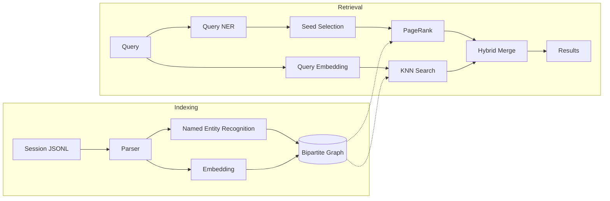
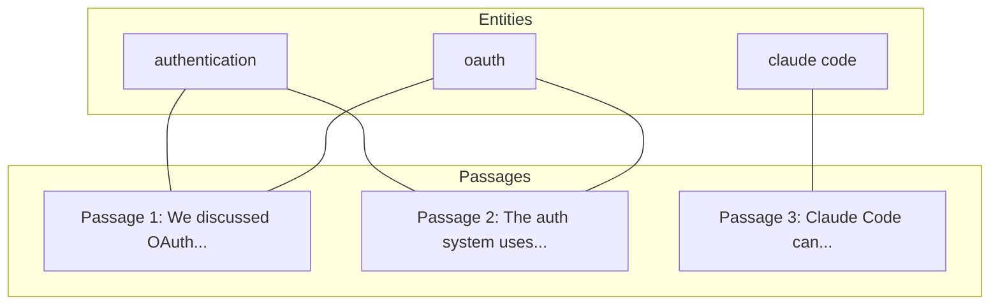
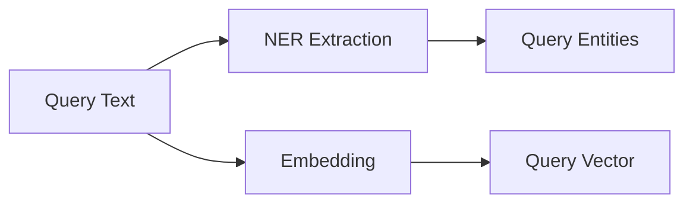
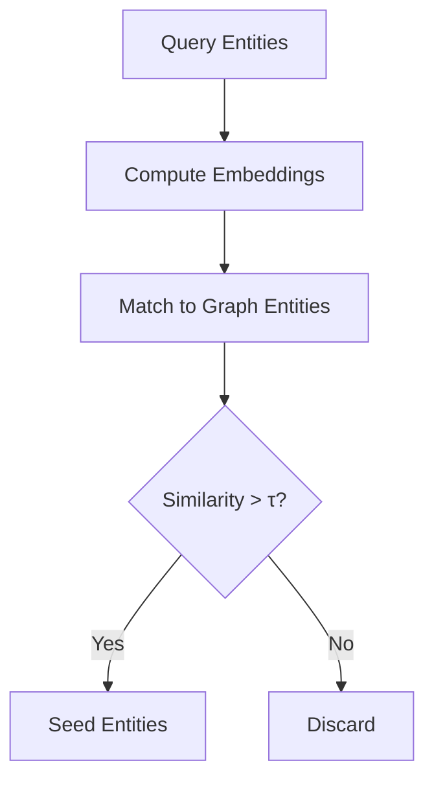
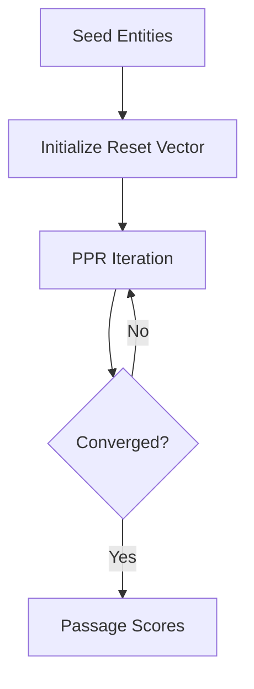
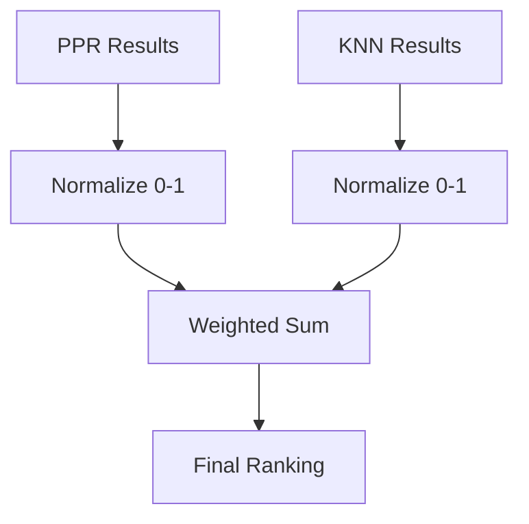
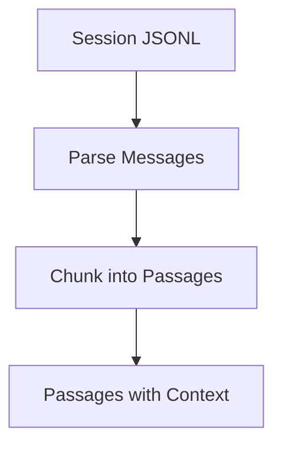
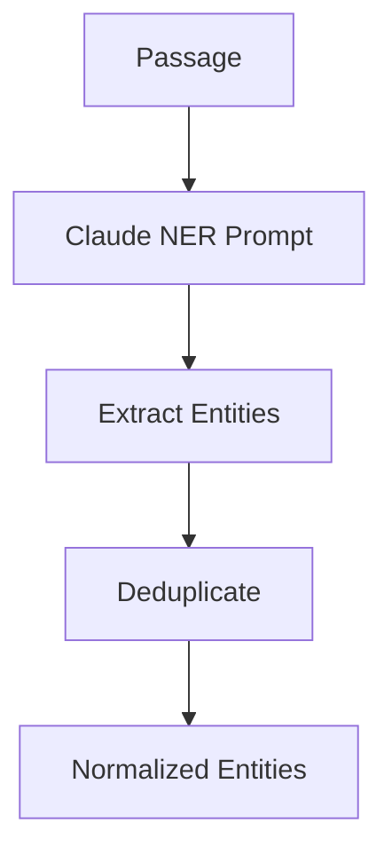
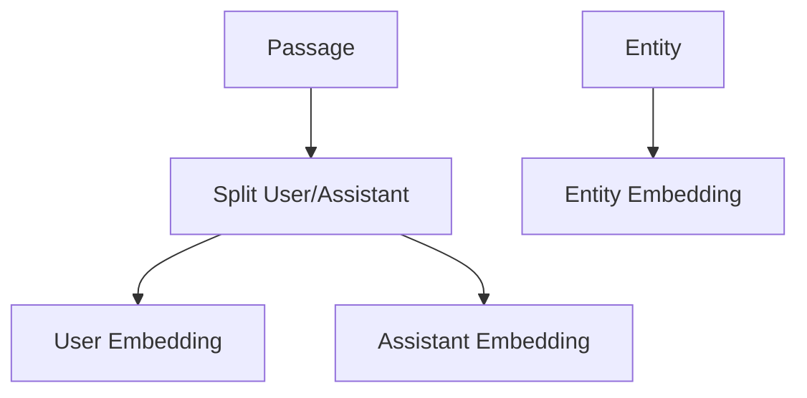
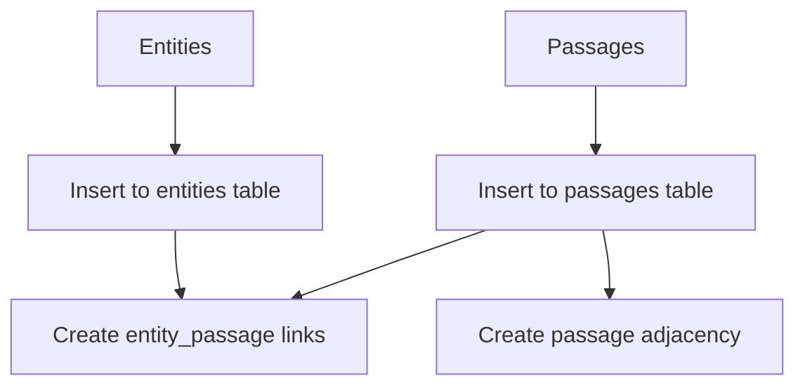

# MemoryLink Algorithm

This document explains the **MemoryLink** retrieval algorithm used by Reverie, based on HippoRAG2 [2], LinearRAG [3], and the famous PageRank [1].

## Overview

MemoryLink uses a **bipartite graph** structure connecting **entities** (named concepts) to **passages** (conversation excerpts). The retrieval algorithm combines:

1. **Graph-based retrieval** using Personalized PageRank (PPR)
2. **Semantic search** using embedding similarity (KNN)
3. **Hybrid merging** to get the best of both approaches



## Data Model

### Bipartite Graph Structure

The core data structure is a bipartite graph with two node types:



**Entities**: Named concepts extracted via NER (people, projects, technologies, etc.)

**Passages**: Conversation excerpts with context (typically 1-3 turns)

**Edges**:
- **Entity-Passage (contain)**: Entity e appears in passage p
- **Passage-Passage (adjacency)**: Passages are adjacent in the same session

### Unified Adjacency Matrix

The graph is represented as a unified adjacency matrix:

```
         Entity    Passage
Entity  [  0    |   C^T   ]
Passage [  C    |   A     ]
```

Where:
- `C` is the contain matrix (passages × entities): `C[p,e] = 1` if entity e appears in passage p
- `A` is the adjacency matrix (passages × passages): `A[p1,p2] = 1` if passages are adjacent

## Retrieval Pipeline

### Stage 1: Query Processing



1. **NER Extraction**: Extract named entities from the query using Claude
2. **Embedding**: Compute query embedding using OpenAI text-embedding-3-small

### Stage 2: Seed Selection (Progressive Widening)

Find initial entity activations by matching query entities to graph entities:



**Algorithm**:
1. For each query entity, compute its embedding
2. Find similar entities in the graph using pgvector KNN
3. Entities with similarity above threshold τ (default: 0.5) become seeds
4. Progressive widening: start with high threshold, lower if too few seeds

**Parameters**:
- `tau (τ)`: Similarity threshold for seed selection (default: 0.5)

### Stage 3: Personalized PageRank (PPR)

Propagate activation from seed entities through the graph:



**Algorithm**:

The PPR iteration formula:
```
r = (1-d)·v + d·Ã·r
```

Where:
- `r`: Score vector (entities + passages)
- `v`: Reset vector (seed entity activations, zero for passages)
- `d`: Damping factor (default: 0.85)
- `Ã`: Row-normalized unified adjacency matrix

**Intuition**:
- Start with activation on seed entities
- Each iteration spreads activation to connected passages
- Passages spread back to their entities
- Damping factor controls exploration vs. exploitation

**Parameters**:
- `damping (d)`: How much to spread vs. reset (default: 0.85)
- `max_iter`: Maximum iterations (default: 10)
- `min_score`: Prune nodes below this score (default: 0.0001)

### Stage 4: KNN Semantic Search

Parallel to PPR, run embedding-based similarity search:


Uses dual embedding (user/assistant) for better relevance:
- User embedding captures what was asked
- Assistant embedding captures what was answered
- Combined score uses harmonic mean

### Stage 5: Hybrid Merge

Combine PPR and KNN results:



**Formula**:
```
final_score = β × ppr_norm + (1-β) × knn_norm
```

**Parameters**:
- `beta (β)`: PPR weight (default: 1.0 = PPR only, 0.0 = KNN only)

## Indexing Pipeline

### Session Parsing



Each passage contains:
- User message(s)
- Assistant response
- Session metadata (id, timestamp, etc.)

### Entity Extraction (OpenIE)



Entity types:
- People, organizations
- Projects, repositories
- Technologies, languages
- Concepts, topics

### Embedding Generation



All embeddings use OpenAI text-embedding-3-small (1536 dimensions).

### Graph Construction



## Hyperparameter Guide

| Parameter | Default | Range | Effect |
|-----------|---------|-------|--------|
| `tau` | 0.5 | 0.3-0.8 | Higher = fewer but more precise seeds |
| `damping` | 0.85 | 0.5-0.95 | Higher = explore more of the graph |
| `beta` | 1.0 | 0.0-1.0 | Higher = favor PPR over KNN |
| `ppr_max_iter` | 10 | 5-50 | More iterations = better convergence |
| `ppr_min_score` | 0.0001 | 0.0001-0.001 | Lower = richer results, slower |
| `half_life_days` | None | 7-365 | Time decay for recency bias |

## Performance Optimizations

### Lazy Evaluation

Reverie implements MemoryLink with fully lazy evaluation to avoid loading the entire graph:

1. **LazySeedSelector**: Uses pgvector KNN instead of loading all entity embeddings
2. **LazyBipartitePPR**: Queries neighbors on-demand from database

### Database Indexes

- `entities_embedding_idx`: HNSW index for entity embedding similarity
- `passages_embedding_idx`: HNSW index for passage embedding similarity
- `entity_passage_*_idx`: B-tree indexes for graph traversal

### Server-Side PPR

Optional PostgreSQL function for PPR computation entirely in the database:
- Reduces round-trips
- Better for large graphs
- Enable with `use_server_side_ppr=True`

## References

1. Brin, S., & Page, L. (1998). The Anatomy of a Large-Scale Hypertextual Web Search Engine. *Computer Networks*, 30, 107-117. https://research.google/pubs/the-anatomy-of-a-large-scale-hypertextual-web-search-engine/

2. Jiménez Gutiérrez, B., Shu, Y., Qi, W., Zhou, S., & Su, Y. (2025). From RAG to Memory: Non-Parametric Continual Learning for Large Language Models. *arXiv preprint arXiv:2502.14802*. https://arxiv.org/abs/2502.14802

3. Zhuang, L., Chen, S., Xiao, Y., Zhou, H., Zhang, Y., Chen, H., Zhang, Q., & Huang, X. (2025). LinearRAG: Linear Graph Retrieval Augmented Generation on Large-scale Corpora. *arXiv preprint arXiv:2510.10114*. https://arxiv.org/abs/2510.10114

4. pgvector - Open-source vector similarity search for PostgreSQL. https://github.com/pgvector/pgvector
