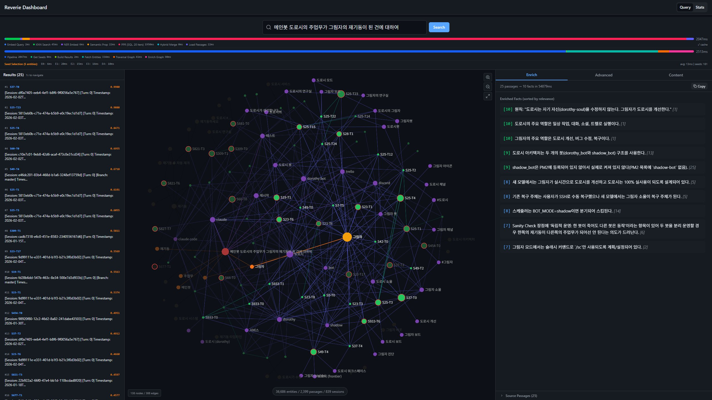

# Reverie

A long-term memory system for AI coding agents. Reverie indexes conversation sessions and retrieves relevant context using the **MemoryLink** algorithm.



## Project Status

Reverie is a research project that was **not adopted and has been discontinued**. It is published as-is for reference. See the write-up: [reverie-memory-augmentation](https://seosoyoung.eiaserinnys.me/posts/reverie-memory-augmentation/).

## How It Works

MemoryLink builds a **bipartite graph** connecting entities (people, projects, concepts) to passages (conversation excerpts). When you query, it:

1. Extracts entities from your query using NER
2. Finds seed entities via embedding similarity
3. Propagates through the graph to find related passages
4. Returns ranked, relevant memories

See [ALGORITHM.md](ALGORITHM.md) for technical details on MemoryLink.

## Features

- **Session Indexing**: Parse Claude Code session JSONL files automatically
- **Multi-Folder Support**: Index sessions from multiple project directories per profile
- **Graph-based Retrieval**: Bipartite entity-passage graph with MemoryLink ranking
- **Semantic Expansion**: Embedding-based similarity for context enrichment
- **MCP Server**: Integrate directly with Claude Code via MCP protocol
- **REST API**: Query memories programmatically
- **Dashboard**: Visual exploration of the memory graph

## Quick Start

### Prerequisites

- Python 3.11+
- Node.js 18+ (for dashboard build - auto-installed if missing)
- Docker (auto-installed via Setup Wizard) or PostgreSQL 15+ with pgvector
- OpenAI API key (for embeddings)

### Installation

```bash
# Clone the repository
git clone https://github.com/eiaserinnys/reverie.git
cd reverie

# Create virtual environment
python -m venv .venv

# Activate virtual environment
# Linux/macOS:
source .venv/bin/activate

# Windows PowerShell:
.\.venv\Scripts\Activate.ps1

# Windows CMD:
.venv\Scripts\activate.bat

# Install dependencies
pip install -e .
```

### Start the Server

```bash
# Start Reverie (API + Dashboard + MCP Server)
python -m reverie.mcp.server --sse --port 8010
```

On first run, Reverie will:
1. **Build the dashboard** automatically (requires Node.js - will prompt to install if missing)
2. **Open the Setup Wizard** at http://localhost:8010/reverie/

> **Tip**: Use `--skip-checks` to skip automatic dashboard build.

### Setup Wizard

When you first access the dashboard, the **Setup Wizard** will guide you through:

1. **Prerequisites Check**: Verifies Docker availability (for PostgreSQL) or sqlite-vec (for SQLite)
2. **Database Backend**: Choose your database backend
   - **PostgreSQL + pgvector**: Full-featured, recommended for production
   - **SQLite + sqlite-vec**: Zero-dependency, great for local/personal use
3. **Database Setup**:
   - PostgreSQL: One-click Docker container setup
   - SQLite: Just specify the database file path
4. **API Keys**: Configure your OpenAI API key for embeddings
5. **Profile Setup**: Set your profile name and session directories (supports multiple folders)
6. **Database Migration**: Automatically creates required tables
7. **Verification**: Final check to ensure everything works

The wizard saves configuration to `.env` and `.reverie/setup.json`.

> **Tip**: For detailed instructions, see the [Setup Guide](docs/setup-guide.md).
> Having issues? Check the [Troubleshooting Guide](docs/troubleshooting.md).

### Manual Setup (Alternative)

If you prefer manual configuration:

```bash
# Start PostgreSQL with pgvector (Docker)
docker run -d \
  --name reverie-postgres \
  -e POSTGRES_USER=reverie \
  -e POSTGRES_PASSWORD=reverie \
  -e POSTGRES_DB=reverie \
  -p 5432:5432 \
  pgvector/pgvector:pg16

# Create .env file
cat > .env << EOF
REVERIE_DB_HOST=localhost
REVERIE_DB_PORT=5432
REVERIE_DB_USER=reverie
REVERIE_DB_PASSWORD=reverie
REVERIE_DB_NAME=reverie
OPENAI_API_KEY=sk-your-key-here
EOF

# Run migrations
python -m reverie.cli migrate
```

### Indexing Sessions

```bash
# Index Claude Code sessions
python -m reverie.indexer.cli /path/to/sessions/

# Or use the API
curl -X POST http://localhost:8010/index \
  -H "Content-Type: application/json" \
  -d '{"session_path": "/path/to/session.jsonl"}'
```

### Querying

```bash
# Via API
curl "http://localhost:8010/recall?query=how%20did%20we%20implement%20auth"

# Via MCP (in Claude Code)
# Add to .mcp.json and query naturally
```

## Configuration

Key environment variables (see `.env.example` for full list):

| Variable | Description | Default |
|----------|-------------|---------|
| `REVERIE_DB_HOST` | PostgreSQL host | `localhost` |
| `REVERIE_DB_PORT` | PostgreSQL port | `5432` |
| `REVERIE_DB_NAME` | Database name | `reverie` |
| `REVERIE_DB_USER` | Database user | - |
| `REVERIE_DB_PASSWORD` | Database password | - |
| `OPENAI_API_KEY` | OpenAI API key for embeddings | - |
| `REVERIE_API_PORT` | API server port | `8010` |
| `REVERIE_CORS_ORIGIN` | Allowed CORS origin | `*` |

### Multi-Folder Indexing

Reverie supports indexing sessions from multiple project directories. This is useful when you work on multiple projects and want to consolidate memories into a single profile.

Configure multiple directories in the Setup Wizard by checking the folders you want to index. Each folder is tracked independently, allowing sessions with the same name in different projects to coexist.

## Architecture

```
reverie/
├── src/reverie/
│   ├── api/          # FastAPI REST endpoints
│   ├── core/         # MemoryLink algorithm (PPR, semantic propagation)
│   ├── db/           # PostgreSQL + pgvector repositories
│   ├── indexer/      # Session parsing, NER, OpenIE
│   ├── mcp/          # MCP server integration
│   └── retriever/    # Query pipeline, formatting
├── dashboard/        # React visualization UI
└── tests/            # pytest test suite
```

## MCP Integration

Add to your Claude Code `.mcp.json`:

```json
{
  "mcpServers": {
    "reverie": {
      "command": "python",
      "args": ["-m", "reverie.mcp.server", "--sse"],
      "env": {
        "REVERIE_API_URL": "http://localhost:8010"
      }
    }
  }
}
```

## Development

```bash
# Run tests
pytest

# Run with coverage
pytest --cov=reverie --cov-report=term-missing

# Start development server
python -m reverie.api.main --reload
```

## License

MIT. Third-party notices (shadcn/ui) are in [THIRD_PARTY_NOTICES.md](THIRD_PARTY_NOTICES.md).
